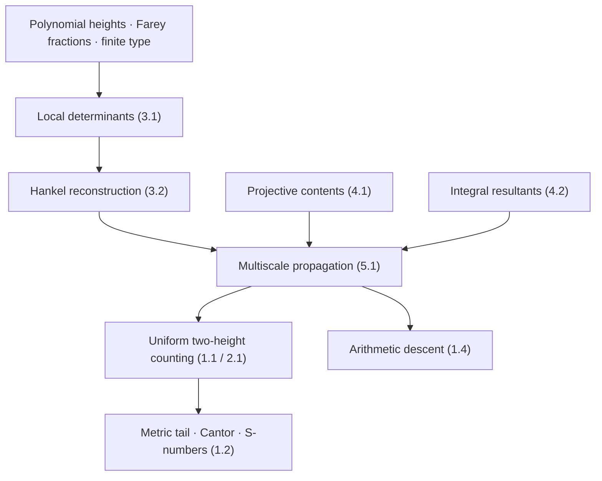

# MahlerLean

**Formal verification of Diophantine approximation and analytic rigidity**  
*A Lean 4 + mathlib research project by Diego Marques · Universidade de Brasília*

[](https://github.com/DiegoMarquesMath/MahlerLean/actions/workflows/lean.yml)
[](https://github.com/DiegoMarquesMath/MahlerLean/pull/4)

MahlerLean develops machine-checked proofs about rational approximation, Liouville numbers, and rigidity of analytic functions. The project preserves a completed **earlier formalization** and develops a separate, more ambitious formalization of **_Diophantine Rigidity of Analytic Graphs_**.

> [!IMPORTANT]
> **Verified code is not the same as a verified manuscript.** The earlier theorems listed below have Lean implementations and a recorded verification history. The new arbitrary-degree counting theorem, S-number Cantor theorem, and arithmetic descent **remain formalization targets**. Their statements must be checked against the revised manuscript before they can be called verified.

## Two research tracks

| | **Mahler's Problem I · Analytic Rigidity** | **Diophantine Rigidity of Analytic Graphs** |
| --- | --- | --- |
| **Mathematics** | Rational-target approximation, Liouville numbers, analytic and entire-function rigidity | Small polynomial values of arbitrary bounded degree, two independent heights, propagation and arithmetic descent |
| **Code** | [`MahlerLean/`](https://github.com/DiegoMarquesMath/MahlerLean/tree/main/MahlerLean) | [`AnalyticGraphs/`](https://github.com/DiegoMarquesMath/MahlerLean/tree/feature/analytic-graphs-formalization/AnalyticGraphs) |
| **Formal status** | Earlier Lean proofs documented and audited | Infrastructure checked; new principal proofs in progress |
| **Evidence** | [Validation record](https://github.com/DiegoMarquesMath/MahlerLean/blob/main/VALIDATION.md) | [Proof-status register](https://github.com/DiegoMarquesMath/MahlerLean/blob/feature/analytic-graphs-formalization/docs/ATH_STATUS.md) · [Draft PR #4](https://github.com/DiegoMarquesMath/MahlerLean/pull/4) |

The two tracks share reusable foundations, **not interchangeable theorem statements**. In particular, the existing degree-one two-height result does not establish the new estimate for integer polynomials of arbitrary bounded degree.

## Mathematics

### I. Earlier machine-checked results

The original development includes the following named Lean declarations. These are statements from the **earlier analytic-rigidity work**, not the numbering of the new manuscript.

| Mathematical result | Lean declaration |
| --- | --- |
| A Cantor set of Liouville arguments with image irrationality exponent at most (100) | [`MahlerLean.current_theorem_1_1`](MahlerLean/CurrentTheoremOne.lean) |
| Liouville preservation forces a real-analytic function to be rational on its interval | [`MahlerLean.current_corollary_1_2`](MahlerLean/CurrentTheoremOne.lean) |
| An entire function preserving every Liouville number is a polynomial with real coefficients | [`MahlerLean.current_theorem_1_3`](MahlerLean/CurrentTheoremOne.lean) |
| Degree-one, two-height rational-target counting | [`MahlerLean.proposition_5_1`](MahlerLean/TwoHeightCounting.lean) |

For example, the established entire-function conclusion is

$$
F\text{ entire},\qquad
F(\mathscr L)\subseteq\mathscr L
\quad\Longrightarrow\quad
F\in\mathbb R[z],
$$

where (mathscr L) is the set of Liouville numbers. The associated proof is in [`EntireRigidity.lean`](MahlerLean/EntireRigidity.lean); its assembly is in [`CurrentTheoremOne.lean`](MahlerLean/CurrentTheoremOne.lean).

The earlier Cantor theorem gives, for the functions covered by its hypotheses, a nonempty compact perfect set (K) of Liouville numbers with

$$
\mu(f(\xi))\le 100\qquad(\xi\in K).
$$

See the [original theorem correspondence](https://github.com/DiegoMarquesMath/MahlerLean/blob/main/docs/FORMALIZATION.md) and [validation record](https://github.com/DiegoMarquesMath/MahlerLean/blob/main/VALIDATION.md) for the exact hypotheses, recorded proof commits, and limits of certification.

### II. New target: two-height rigidity of analytic graphs

For a reduced rational argument (r=p/q) with (Q\le q<2Q), consider nonzero integer polynomials (P\in\mathbb Z[Y]) satisfying

$$
\deg P\le m,\qquad
B\le H(P)<2B,\qquad
|P(f(r))|\le L B^{-w}.
$$

Here (H(P)) is the **maximum absolute coefficient**, and each rational argument is counted **once**, even if it has several witnesses. Exact zeros are included.

The new manuscript's central target is a uniform power saving

$$
\boxed{N_{f,m}(Q,B,w)\ll Q^{2-\eta}}
\qquad
\bigl(w>2m-1,\ \ Q^{u_0}\le B\le Q^U\bigr)
$$

for real-analytic graphs transcendental over (mathbb R(X)), with a corresponding uniform formulation for smooth families of finite algebraic type.

Its Diophantine consequence aims to construct, inside **every** nonempty open subinterval, a single Cantor set (K\subseteq\mathscr L) such that

$$
f(\xi)\ \text{is transcendental},\qquad
w_m(f(\xi))\le 2m-1\ \ (\forall m\ge1),\qquad
\mu(f(\xi))=2
$$

for **every** (\xi\in K). A separate application is **arithmetic descent**: recovering the rationality of an algebraic analytic branch's defining equation from sufficiently frequent approximate specializations at the critical height (Q^d).

**These are mathematical targets, not yet Lean-certified theorems.** The entire-function conclusion is already available through the earlier proof route, while its derivation specifically through the new S-number theorem remains to be formalized.

## Proof architecture



Each dependency is intended to be a separately reviewed Lean theorem. Particularly demanding obligations are the two-chart (p)-adic content estimate, preservation of one polynomial across propagation scales, and the positive-measure Cantor induction.

The work is organized into **12 verification gates**: statement audit; arithmetic foundations; finite algebraic type; determinants; Hankel recovery; projective contents; resultants; propagation; counting; Cantor/S-numbers; arithmetic descent; and final certification.

**Follow the [12-stage roadmap](https://github.com/DiegoMarquesMath/MahlerLean/blob/feature/analytic-graphs-formalization/docs/ATH_FORMALIZATION.md), [precise proof contracts](https://github.com/DiegoMarquesMath/MahlerLean/blob/feature/analytic-graphs-formalization/docs/ATH_PROOF_CONTRACTS.md), and [reuse map](https://github.com/DiegoMarquesMath/MahlerLean/blob/feature/analytic-graphs-formalization/docs/ATH_REUSE_MAP.md).**

## Current verification status

| Area | Evidence | Status |
| --- | --- | --- |
| Historical MahlerLean theorems | [Lean declarations](https://github.com/DiegoMarquesMath/MahlerLean/tree/main/MahlerLean) · [validation history](https://github.com/DiegoMarquesMath/MahlerLean/blob/main/VALIDATION.md) | Previously verified |
| New `AnalyticGraphs` scaffold | [GitHub Actions run](https://github.com/DiegoMarquesMath/MahlerLean/actions/runs/41763448379) | CI passed at the recorded commit |
| Revised manuscript ↔ Lean statements | Author's local statement audit; not published in this repository | Not yet signed off |
| New arbitrary-degree count, simultaneous S-number images, and descent | [Milestone tracker](https://github.com/DiegoMarquesMath/MahlerLean/blob/feature/analytic-graphs-formalization/docs/ATH_STATUS.md) | Not yet formalized |

A **green badge confirms only the tests actually executed on that commit**. It is not a claim that all theorems described in the project have been formalized.

## Reproduce the Lean checks

Lean **4.24.0** and the matching mathlib version are pinned by [`lean-toolchain`](lean-toolchain), [`lakefile.toml`](lakefile.toml), and [`lake-manifest.json`](lake-manifest.json).

```bash
git clone https://github.com/DiegoMarquesMath/MahlerLean.git
cd MahlerLean
lake exe cache get
bash scripts/check.sh
```

To check the new development branch:

```bash
git fetch origin
git switch feature/analytic-graphs-formalization
lake exe cache get
bash scripts/check_analytic_graphs.sh
```

The checks build the relevant Lean sources and inspect the recorded principal declarations for admitted placeholders. An independent **statement-fidelity review** is also mandatory: no proof is labeled complete merely because Lean accepted a theorem of a different type, with stronger assumptions, weaker quantifiers, or unapproved axioms.

## Repository guide

| Resource | Purpose |
| --- | --- |
| [Legacy proof modules](https://github.com/DiegoMarquesMath/MahlerLean/tree/main/MahlerLean) | Existing formal developments and reusable infrastructure |
| [AnalyticGraphs modules](https://github.com/DiegoMarquesMath/MahlerLean/tree/feature/analytic-graphs-formalization/AnalyticGraphs) | New paper's separate proof workstream |
| [Formalization roadmap](https://github.com/DiegoMarquesMath/MahlerLean/blob/feature/analytic-graphs-formalization/docs/ATH_FORMALIZATION.md) | The twelve completion gates and mathematical dependencies |
| [Proof contracts](https://github.com/DiegoMarquesMath/MahlerLean/blob/feature/analytic-graphs-formalization/docs/ATH_PROOF_CONTRACTS.md) | Assumptions, constants, quantifiers, and edge cases |
| [Verification policy](https://github.com/DiegoMarquesMath/MahlerLean/blob/feature/analytic-graphs-formalization/docs/ATH_VERIFICATION.md) | Proof integrity and theorem-status requirements |
| [Agent instructions](https://github.com/DiegoMarquesMath/MahlerLean/blob/feature/analytic-graphs-formalization/AGENTS.md) | Codex rules: no `sorry`, hidden assumptions, or false completion claims |
| [Contributing](https://github.com/DiegoMarquesMath/MahlerLean/blob/feature/analytic-graphs-formalization/CONTRIBUTING.md) | Development and review protocol |
| [Draft PR #4](https://github.com/DiegoMarquesMath/MahlerLean/pull/4) | Reviewable ongoing work, kept separate from `main` |

The exact revised manuscript `ATH_rev.tex` and `ATH_rev.pdf` remains in the author's local workspace and is **not published in this repository**. Public source release, if any, is a separate author decision.

## Citation and provenance

Use [`CITATION.cff`](CITATION.cff) to cite the software. For a mathematical theorem, additionally cite the corresponding paper and **the exact proof commit**; a branch name or current badge is not a permanent proof reference.

Earlier completed proof checkpoint: [`dcbac6a16e910c22155e4882a3b11b2bb0c66222`](https://github.com/DiegoMarquesMath/MahlerLean/tree/dcbac6a16e910c22155e4882a3b11b2bb0c66222). Verification and scope are described in [`VALIDATION.md`](VALIDATION.md).

---

**Maintainer:** [Diego Marques](https://github.com/DiegoMarquesMath) · Department of Mathematics, Universidade de Brasília.  
**Principle:** *State the theorem exactly. Check the proof mechanically. Record what remains open.*
